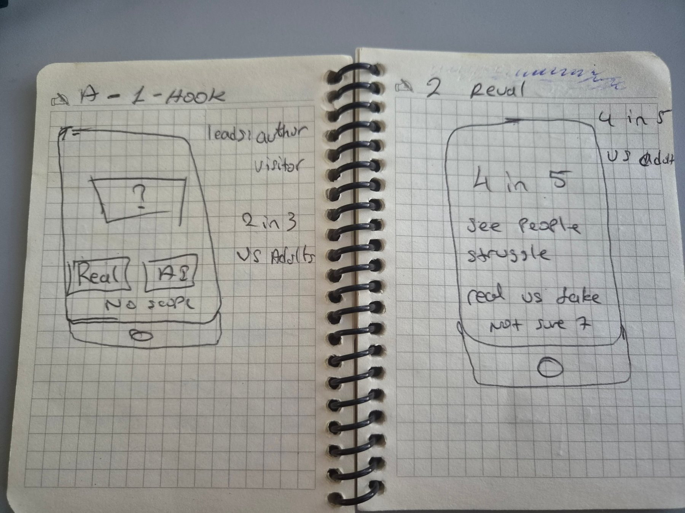

# Implementation plan

**Worried, but it's coming anyway** · Data Storytelling HS26 · Adhurim Thaqi (solo) · 29.10.2026  
Data: *Americans on AI*, Athena Insights with NORC, all US adults, survey 10–14 Sep 2026, n = 1,083, margin of error about ±4 points.

## 1 · Concept

For young adults in Switzerland (20–35) who use AI but are undecided, on their phone, in two minutes.
The question, word for word: *"Thinking about AI's growing role in society, which of these options comes closest to how you feel, even if none are exactly right?"*
The reader guesses whether four valley pictures are real or AI-made against a 5-second clock, then sees that 57 of 100 Americans see people struggling to tell real from fake. They answer the question and see their dot among 1,000 US adults, by age.
They take away: most Americans are worried, most think AI is coming anyway, and younger adults are more likely than older adults to think it can still be shaped.

## 2 · Tone

**Three adjectives**

| | What it means for the page |
|---|---|
| **Playful** | The hook is a game: a clock with funny lines, a burning fuse, a score. Testers called it "a fun game challenge, not a quiz". |
| **Honest** | Every number is from the official dataset, "not sure" and "no answer" stay visible, and gaps inside the margin of error aren't called gaps. The source is on the page. |
| **Personal** | You guess first, you answer the survey's own question, and your own dot sits among 1,000 Americans. It's about *you* compared with a representative sample, not about a comment section. |

**References and what we borrow**

| Reference | What we borrow | What we don't |
|---|---|---|
| **Which Face Is Real?** (J. West & C. Bergstrom, University of Washington), whichfaceisreal.com | A big pool, drawn at random, so every round is new. Show what it was right after each answer. | Endless rounds (ours stops after 4); faces of real people (we use landscapes) |
| **NYT The Upshot, "You Draw It"** (2015) | Commit to a guess first, then the data appears next to your answer, so the real number sticks. | Drawing a line. Ours is a two-button choice you make with your thumb in 5 seconds. |
| **Pew Research Center, Political Typology Quiz**, pewresearch.org | The survey's own question, word for word, and placing *you* inside a representative sample | Many questions and a label for the visitor; political groups as the default view |

**The key moment, sketched by hand** (direction A, frames 1 "Hook" and 2 "Reveal")

## 3 · Architecture

**What is real, what is facade?**

| Real (works and is true) | Facade (looks real, but is a simplification or staged) |
|---|---|
| Every percentage is read from the official CSV by `data_cut.py` and checked by a script | **The 1,000 dots aren't real respondents.** One dot = 1 in 1,000 of a published share, not a person from the raw data (we don't have the raw data). |
| The random draw (2 real + 2 AI), the clock and the score | **"Your dot" isn't added to the survey.** It's shown next to the data, not counted in it. |
| The visitor's answer is placed in the right block of the dot field | **No live data.** "Latest wave" is fixed when I run `build.py`, not fetched live. |
| The margin-of-error rule decides whether the text says "more", "less" or "about the same" | **The pictures are hand-picked**, all the same kind of scene, so the game is fair. They don't stand for "AI pictures" in general. |
| Works without a server; nothing about the visitor is sent anywhere | **No backend.** Nothing is saved except the list of pictures already seen, and that stays in the browser. |

## 4 · Backward plan (from 17.12 back to today)

**Core** = it must work, even if everything else is cut. **Nice** = only if there is time.

| Week · date | Milestone | Core | Nice to have |
|---|---|---|---|
| **W51 · 17.12** | Presentation to Interactive Things | Live demo on a phone and 7-minute talk | Backup video of the demo |
| **W50 · 10.12** | Final version and short rationale (max. 2 pages) | Final version frozen; rationale: what, why, what the test showed | Dark mode check, text polish |
| **W49 · 03.12** | Fixes from the user test | The top 3 problems from W48 are fixed | Smaller wording and layout fixes |
| **W48 · 26.11** | User test done, results written up | 5 people from the target group; "What did you take away?" and "Which number do you remember?" written down in `W48_user-test/` | One extra interview with someone 50+ |
| **W47 · 19.11** | Testable prototype: core interaction with real data | Steps 1–6 run in one go on one phone (Chrome on Android); every number from `build.py`; check script 0 mismatches | Autoplay for people who don't click; pictures saved locally (works offline) |
| **W46 · 12.11** | Sprint 1 done | **v5: the v4 hook merged with steps 2–6 into one file** (see sprint plan) | Age tabs for all four age groups |
| **W45 · 05.11** | Implementation plan and sprint plan; sprint 1 starts | These two documents in the research documentation | — |
| **W44 · 29.10** (today) | Feasibility | v4 done (random pool of 16 pictures); test results written up | — |

**Cut first (nice to have, in this order):**

1. other groups (gender, party, race)
2. a trend over several waves
3. sound and a share button
4. working in every browser

**Reflection (slide 8)**

- **What must it do, even if everything else is cut?**
    - the guess
    - the 57
    - your answer as a dot among 1,000
    - the key message, with correct numbers
- **Which milestone am I least sure about?** W47. Joining the hook with steps 3–6 could break the tone: the hook is a fun game, and the steps after it are calm data. The W48 test has to show whether the change feels natural.
- **What would I drop first?** Autoplay and the extra age tabs. Two groups (18–34 vs 65+) are enough for the turn.
